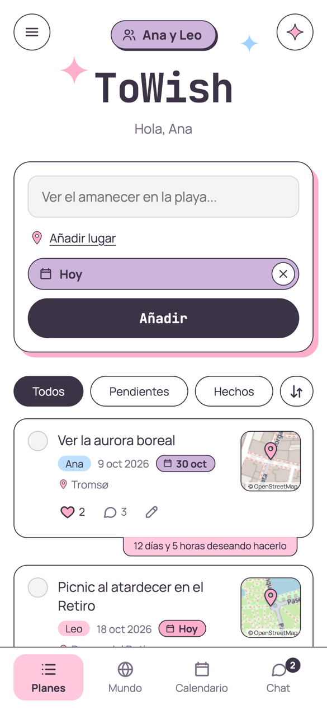
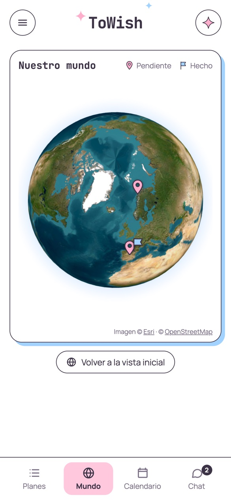
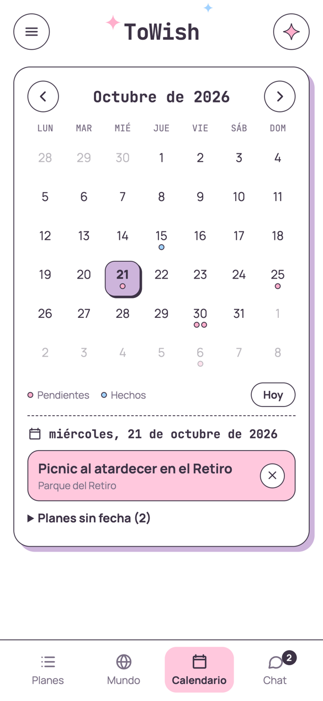
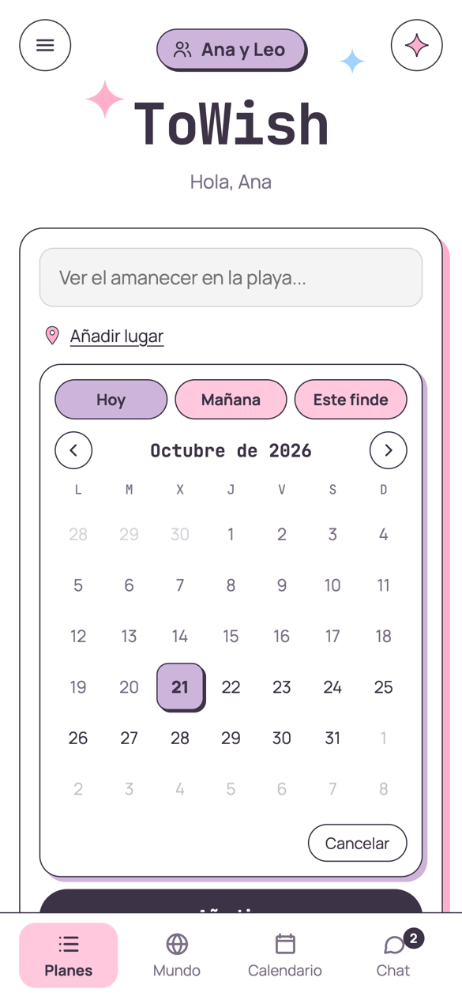
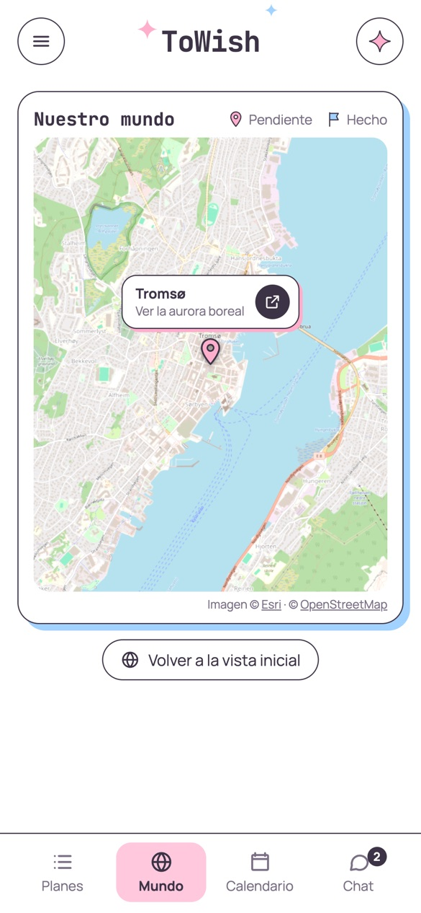
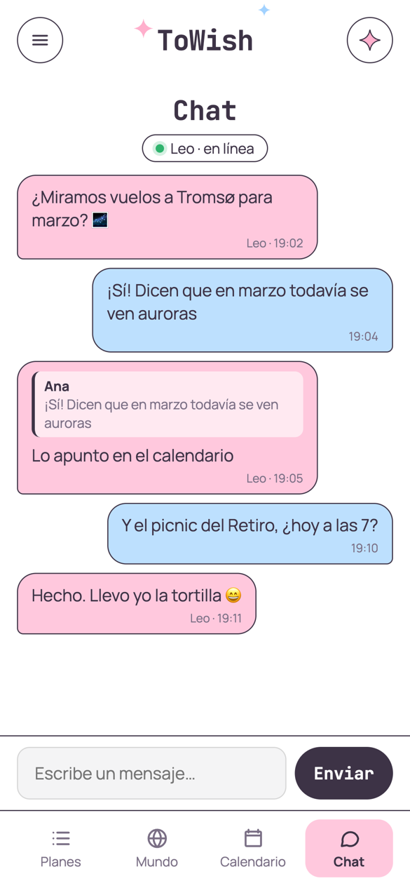
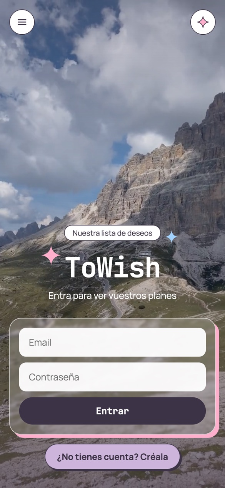
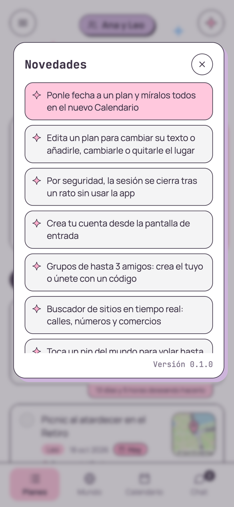

<div align="center">


# ToWish ✦

**La lista de deseos para hacer cosas juntos.**

Apuntad lo que queréis vivir, ponedle un sitio y una fecha, comentadlo, chatead<br />
y ved todos vuestros planes repartidos por un globo 3D.

[**Abrir ToWish →**](https://towish.netlify.app)

<br />


</div>

<br />

<table>
  <tr>
    <td align="center" width="33%"><br /><sub><b>Vuestros planes</b></sub></td>
    <td align="center" width="33%"><br /><sub><b>Vuestro mundo</b></sub></td>
    <td align="center" width="33%"><br /><sub><b>Vuestro calendario</b></sub></td>
  </tr>
</table>

> Las capturas usan datos de ejemplo.

---

## ✦ Qué es

ToWish es una pequeña app para **grupos de hasta 3 personas** (pareja, amigos, familia) que quieren llevar juntos su lista de cosas pendientes por hacer: ese viaje, ese restaurante, ese concierto…

Todo se comparte **en tiempo real**: lo que apunta uno aparece al momento en el móvil de los demás. Se instala como una app más y **avisa de los mensajes** aunque esté cerrada.

---

## ✦ Planes

<table>
  <tr>
    <td width="50%" valign="top">

- **Apunta un plan** y, si quieres, ponle **lugar** (con sugerencias mientras escribes, o pegando un link de Google Maps) y **fecha** (hoy, mañana, este finde o cualquier día).
- Cada plan enseña un **minimapa** que abre la ruta en Google Maps.
- **Me gusta**, **comentarios** y **editar** en cada tarjeta.
- Marca lo que ya habéis hecho y mira **cuánto tiempo lleváis deseando** lo que falta.
- **Desliza a la derecha para borrar** (con 5 segundos para deshacer).
- Filtros por pendientes y hechos, y orden por fecha.

    </td>
    <td width="50%" align="center"></td>
  </tr>
</table>

---

## ✦ Mundo

<table>
  <tr>
    <td width="50%" align="center"></td>
    <td width="50%" valign="top">

- Un **globo 3D** con un **pin** por cada sitio que tenéis pendiente y una **bandera** por cada plan hecho.
- Satélite de lejos y mapa de calles de cerca, con una transición de **caída entre nubes**.
- **Toca un pin** y la cámara vuela hasta allí: sale el nombre del sitio, el plan y un botón para abrirlo en Google Maps.

    </td>
  </tr>
</table>

---

## ✦ Calendario y chat

<table>
  <tr>
    <td width="50%" valign="top">

**Calendario**
- Mes a mes, con un punto en cada día que tiene planes (rosa si está pendiente, azul si está hecho).
- Toca un día para ver sus planes, y pon en él los que aún no tienen fecha.

**Chat**
- El chat del grupo, viendo **quién está conectado**.
- Desliza a la izquierda para **responder** y a la derecha para **borrar** tus mensajes.
- **Notificaciones** al móvil cuando te escriben, aunque la app esté cerrada.

    </td>
    <td width="50%" align="center"></td>
  </tr>
</table>

---

## ✦ Grupos, cuentas y lo demás

<table>
  <tr>
    <td width="50%" align="center"></td>
    <td width="50%" valign="top">

- **Crea tu cuenta** en la propia pantalla de entrada.
- **Crea un grupo** e **invita** con un código de 6 letras, un enlace o directamente por **WhatsApp**.
- Puedes estar en **varios grupos**; cada uno solo ve lo suyo.
- **Tres idiomas:** español, ruso e italiano.
- **Instalable** en el móvil y en el ordenador (PWA).
- **Novedades** a un toque, en el botón ✦ de arriba a la derecha.
- Cierre de sesión automático tras un rato sin usar la app, y opción de **eliminar tu cuenta**.

    </td>
  </tr>
</table>

<div align="center"></div>

---

## ✦ Hecho con

| | |
| --- | --- |
| **Web** | [Next.js 16](https://nextjs.org), React 19, TypeScript y CSS propio (sin librerías de interfaz) |
| **Datos, cuentas y tiempo real** | [Appwrite Cloud](https://appwrite.io) (Frankfurt) |
| **Lógica de servidor** | Appwrite Functions (Node 24) |
| **Avisos** | Web Push con un service worker propio |
| **Globo y mapas** | [globe.gl](https://globe.gl), [Esri World Imagery](https://www.esri.com/) y [OpenStreetMap](https://www.openstreetmap.org/copyright) |
| **Búsqueda de sitios** | [Geoapify](https://www.geoapify.com/), [Photon](https://photon.komoot.io/) y [Nominatim](https://nominatim.org/) |
| **Hosting** | [Netlify](https://www.netlify.com/) |

---

## ✦ Para desarrolladores

<details>
<summary><b>Ponerlo en marcha</b></summary>

<br />

**Requisitos:** Node.js 20 o superior, un proyecto en [Appwrite Cloud](https://cloud.appwrite.io) y, opcionalmente, una clave gratuita de [Geoapify](https://myprojects.geoapify.com/) para las sugerencias de sitios.

```bash
npm install
npm run dev
```

El endpoint y el ID del proyecto de Appwrite están en `app/proyecto.ts` (son públicos: lo que protege los datos son el login y los permisos). Cámbialos por los de tu proyecto y añade `localhost` y tu dominio como plataformas web en la consola de Appwrite.

**Variables de entorno** (en `.env.local` y en Netlify):

| Variable | Para qué |
| --- | --- |
| `NEXT_PUBLIC_GEOAPIFY_KEY` | Sugerencias de sitios. Sin ella se usa Photon (más lento y con direcciones peores). Conviene restringirla por dominio en el panel de Geoapify |

`URL` la pone Netlify sola (se usa como base de las URLs de Open Graph).

**Desplegar la web:**

```bash
netlify deploy --build --prod
```

**Comprobaciones:**

```bash
npx tsc --noEmit            # tipos
npm run lint                # ESLint
node --test app/*.test.ts   # tests (tiempo, links de Google Maps, fechas y errores de contraseña)
```

</details>

<details>
<summary><b>Base de datos (Appwrite TablesDB)</b></summary>

<br />

Base de datos `nuestra-lista`. Todas las tablas con **seguridad por fila** y, a nivel de tabla, solo `create("users")`: quién puede leer cada fila lo dicen sus propios permisos (el equipo del grupo). Cada grupo es un **Team** de Appwrite; quien lo crea tiene el rol `owner`.

| Tabla | Columnas | Permisos de cada fila |
| --- | --- | --- |
| `planes` | `texto`, `quien`, `hecho`, `lugar`, `lat`, `lng`, `likes[]`, `grupo`, `fecha` (`AAAA-MM-DD`) | leer, editar y borrar: el grupo |
| `mensajes` | `texto`, `autor`, `autorId`, `respondeA`, `respondeAutor`, `respondeTexto`, `grupo` | leer: el grupo · editar y borrar: el autor |
| `comentarios` | `planId`, `texto`, `autor`, `autorId`, `grupo` | leer: el grupo · editar y borrar: el autor |
| `reacciones` | `comentarioId`, `userId`, `grupo` (índice único por comentario y persona) | leer: el grupo · borrar: quien reaccionó |
| `suscripciones` | `userId`, `endpoint`, `p256dh`, `auth` | leer y borrar: el propio usuario |
| `grupos` | `nombre`, `codigo` (índice único) | leer: el grupo · solo la escribe la función `grupos` |
| `intentos` | `userId` | ninguno: solo el servidor (cuenta los códigos de invitación fallidos) |

Índices `key` sobre `grupo` en planes, mensajes, comentarios y reacciones, y sobre `planId` en comentarios.

</details>

<details>
<summary><b>Funciones de servidor (Appwrite Functions)</b></summary>

<br />

| Función | Se dispara | Permisos (scopes) |
| --- | --- | --- |
| `grupos` | La app la ejecuta (`execute: users`) con `{ accion: "crear" \| "unirse" \| "borrar" \| "eliminar-cuenta" }` | `teams.read`, `teams.write`, `rows.read`, `rows.write`, `users.read`, `users.write` |
| `avisar-mensaje` | Evento `tablesdb.nuestra-lista.tables.mensajes.rows.*.create` | `rows.read`, `rows.write`, `presences.read`, `teams.read` |

`avisar-mensaje` necesita las variables `VAPID_PUBLIC`, `VAPID_PRIVATE` (secreta) y `VAPID_SUBJECT` (por ejemplo `mailto:tu@email`). Se generan con `npx web-push generate-vapid-keys`; la pública también va en `app/notificaciones.ts`.

```bash
npx appwrite-cli functions create-deployment --function-id grupos \
  --code functions/grupos --entrypoint src/main.js \
  --commands "npm install --omit=dev" --activate
```

</details>

<details>
<summary><b>Estructura del código</b></summary>

<br />

```
app/
  page.tsx                 Pantalla principal: entrada/alta, grupos, planes y pestañas
  Calendario.tsx           Pestaña de calendario mensual
  CampoFecha.tsx           Selector de fecha propio (atajos y mini calendario)
  fechas.ts                Fechas de calendario (AAAA-MM-DD) sin líos de zona horaria
  EditarPlan.tsx           Editar texto, lugar y fecha de un plan
  SelectorLugar.tsx        Buscador de sitios (sugerencias y links de Google Maps)
  lugar.ts                 Búsqueda de sitios, links de Google Maps y teselas
  api/lugar/route.ts       Resuelve links de Google Maps en el servidor (con sesión)
  Mundo.tsx                Globo 3D, marcadores, vuelo y transición de nubes
  nubes.ts                 Nubes procedurales (ruido fractal en canvas)
  Chat.tsx                 Chat del grupo, presencia y no leídos
  Comentarios.tsx          Comentarios de un plan, con me gusta, editar y borrar
  Lateral.tsx              Barra lateral: cuenta, grupo, avisos e idioma
  FormGrupo.tsx            Crear grupo / unirse con código
  grupos.ts                Llamadas a Teams y a la función «grupos»
  Novedades.tsx            Botón y popup de novedades
  Instalar.tsx             Propuesta de instalar la app
  AvisoNotificaciones.tsx  Propuesta de activar los avisos
  notificaciones.ts        Suscripción a Web Push
  Deslizable.tsx           Elemento que se desliza (borrar / responder)
  borrado.ts               Borrado con deshacer
  claves.ts                Mensajes claros cuando se rechaza una contraseña
  i18n.ts                  Textos en es / ru / it
  appwrite.ts, proyecto.ts Cliente y datos públicos del proyecto de Appwrite
  opengraph-image.tsx      Imagen para compartir
functions/
  grupos/                  Crear, unirse (máx. 3), borrar grupos y eliminar cuentas
  avisar-mensaje/          Push a los demás del grupo al llegar un mensaje
public/
  sw.js                    Service worker (avisos y abrir el chat)
  videos/                  Fondos de la pantalla de entrada
```

</details>

<details>
<summary><b>Seguridad</b></summary>

<br />

- **Permisos por fila:** ninguna tabla se puede leer solo por tener cuenta; cada fila lleva los permisos del equipo del grupo (Appwrite los aplica en el servidor, también en el tiempo real).
- **El servidor decide lo importante:** el límite de 3 personas, unirse con código, borrar grupos y eliminar cuentas van en una función con sus propias comprobaciones.
- **Códigos de invitación:** como máximo 5 fallos cada 15 minutos por cuenta (los cuenta una tabla que solo toca el servidor).
- **Avisos push:** el servidor solo envía a los servicios de Chrome, Firefox, Safari y Edge (lista cerrada, contra SSRF) y solo si quien escribe el mensaje es del grupo.
- **Política de contenido (CSP)** y cabeceras de seguridad (HSTS, Permissions-Policy, anti-iframe…): la página solo carga y se conecta a los servicios que usa. Si se añade uno nuevo, hay que añadirlo en `next.config.ts`.
- **`/api/lugar` exige sesión** (token de Appwrite) y solo sigue enlaces de Google.
- **Contraseñas:** mínimo 8 caracteres, sin las del diccionario ni con datos personales; sesiones de 30 días como máximo.
- **Límites conocidos:** dentro de un grupo, alguien podría escribir mensajes o reacciones con el nombre de otro miembro (confianza entre amigos), y no se verifica el email al darse de alta.

</details>

<details>
<summary><b>Algunas decisiones</b></summary>

<br />

- **Borrado con deshacer:** el plan, mensaje o comentario desaparece al momento, pero solo se borra en Appwrite si no se deshace en 5 segundos.
- **Likes atómicos** con operadores de Appwrite (`arrayAppend` / `arrayRemove`): no se pierde uno si dos personas pulsan a la vez.
- **Sin librerías de interfaz:** diálogos nativos (`<dialog>`), animaciones CSS ligadas al scroll y CSS propio con la paleta pastel.
- **Fechas como texto `AAAA-MM-DD`:** un plan para el sábado sigue siendo el sábado en cualquier zona horaria.
- **Búsqueda de sitios:** Nominatim no permite usarse para autocompletar, así que las sugerencias van por Geoapify (o Photon) y Nominatim solo para la búsqueda al pulsar «Buscar».
- **La transición de nubes** tapa el globo mientras cambia de satélite a mapa y no se despeja hasta que han cargado las teselas nuevas.

</details>

---

<div align="center">
<sub>
Imágenes de satélite © Esri · Mapas © colaboradores de OpenStreetMap · Búsqueda de sitios: Geoapify, Photon (Komoot) y Nominatim · Tipografías: Manrope y JetBrains Mono
</sub>
</div>
